  

###

<h1 data-importer="text" align="center">Ednilson Vargas(Edw0w)👋</h1>

  

###

<h2 align="center">📊 Estatísticas do GitHub</h2>

<table align="center">
  <tr>
    <td align="center">
      
    </td>
    <td align="center">
      
    </td>
  </tr>
  <tr>
    <td align="center">
      
    </td>
    <td align="center">
      
    </td>
  </tr>
</table>

###

<h3 data-importer="text" align="center">Sobre mim</h3>

###

Sou estudante de Sistemas de Informação e tenho formação técnica em Informática para Internet. Tenho interesse no desenvolvimento Back-End, criação de sistemas, modelagem de dados e soluções tecnológicas. Busco aprimorar continuamente meus conhecimentos em programação e banco de dados, desenvolvendo projetos práticos e explorando novas tecnologias.

###

  
  
  
  

###

