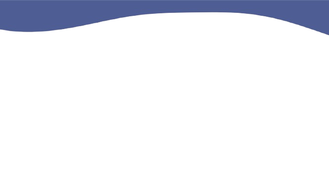

<h1 align="center">Ednilson Vargas(Edw0w) 👋</h1>

  

JavaScript | SQL Server | PHP | Python  

<h2 align="center">Sobre mim</h2>

  

    Sou estudante de Sistemas de Informação e tenho
    formação técnica em Informática para Internet. Tenho interesse no desenvolvimento Back-End,
    criação de sistemas, modelagem de dados e
    soluções tecnológicas. 
    Busco aprimorar continuamente meus conhecimentos
    em programação e banco de dados, desenvolvendo
    projetos práticos e explorando novas tecnologias.
  

  

<table align="center" style="width: 100%">
  <tr>
    <td>
      
    </td>
    <td>
      
    </td>
    <td>
      
    </td>
  </tr>
</table>

